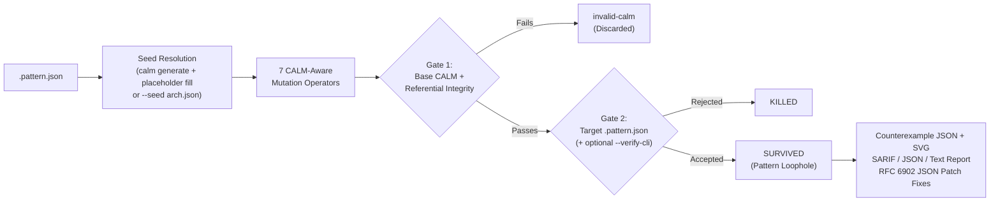

# calm-mutate

Adversarial mutation testing for **FINOS CALM** (`.pattern.json`) architecture patterns.

`calm-mutate` tests whether a CALM pattern actually rejects non-compliant architectures, or whether real-world violations silently slip past it.

---

## Why `calm-mutate`?

Validating an architecture against a CALM `.pattern.json` checks whether **one** architecture passes. It does not check whether the pattern itself has blind spots—for example:

- Missing `controls` in a node or relationship `required` array
- Unconstrained `protocol` values allowing `HTTP` instead of `HTTPS`/`mTLS`
- Missing `maxItems` / `unevaluatedItems` allowing rogue services, shadow LLMs, or unguarded edges
- Missing `interfaces` or `deployed-in` zone membership enforcement

`calm-mutate` answers: **"If an architect or code generator introduces a realistic security or governance violation, will my `.pattern.json` actually catch it?"**

---

## How It Works



1. **Seed Resolution**: Synthesizes a baseline architecture from your `.pattern.json` using `@finos/calm-cli generate` (automatically filling `[[ PLACEHOLDER ]]` and `-1` sentinel values), or loads an existing architecture via `--seed`.
2. **Semantic Mutation**: Applies 7 CALM-aware adversarial operators to the baseline without mutating the seed in place.
3. **Two-Gate Differential Oracle**:
   - **Gate 1 (Base CALM + Referential Integrity)**: Validates each mutant against the base CALM schema and checks `unique-id` uniqueness and relationship endpoint references (`connects`, `interacts`, `deployed-in`, `composed-of`). Illegal CALM mutants are marked `invalid-calm` and excluded from the denominator.
   - **Gate 2 (Target Pattern)**: Validates each legal CALM mutant against the target `.pattern.json`. If it passes, it **SURVIVED**—exposing a real pattern bypass. Passing `--verify-cli` cross-checks every survivor against `@finos/calm-cli validate`.
4. **Actionable Remediation**: Computes a mutation score (`killed / validMutants * 100`), optionally exports surviving `.architecture.json` files and annotated `.svg` diffs, and generates RFC 6902 JSON Patch fixes (`--fix` / `--apply-fix`).

---

## Installation & Build

Requires Node.js `>=20`.

```bash
git clone <your-repo-url> calm-mutate
cd calm-mutate
npm install
npm run build
```

Development scripts:

```bash
npm run typecheck   # tsc --noEmit
npm run build       # tsup ESM + .d.ts bundle
npm test            # vitest run (unit & integration tests)
```

To use `calm-mutate` globally on your PATH:

```bash
npm link
calm-mutate --help
```

---

## CLI Reference

```text
Usage: calm-mutate [options]
```

| Flag | Alias | Default | Description |
|---|---|---|---|
| `--pattern <path>` | `-p` | *(required)* | Path to CALM `.pattern.json` file |
| `--seed <path>` | `-a` | auto-generated | Optional conforming architecture JSON seed |
| `--waivers <path>` | `-w` | | Optional waiver JSON file for documented pattern exceptions |
| `--operators <list>` | | all 7 operators | Comma-separated subset of operators to run |
| `--min-score <number>` | | `0` | Minimum required mutation score (`0`–`100`); exits non-zero if below |
| `--format <type>` | | `text` | Output format: `text`, `json`, or `sarif` |
| `--out-dir <dir>` | | | Write `mutation-report.json` and surviving mutant `.architecture.json` files |
| `--svg` | | `false` | Export annotated `.svg` counterexample diagrams to `--out-dir` |
| `--fix` | | `false` | Print suggested RFC 6902 JSON Patch fixes for surviving mutants |
| `--apply-fix <path>` | | | Write a hardened copy of the pattern with suggested fixes applied |
| `--verify-cli` | | `false` | Cross-verify surviving mutants using `@finos/calm-cli validate` |
| `--version` | `-V` | | Print CLI version |
| `--help` | `-h` | | Display help |

---

## Mutation Operators

| Operator ID | Target | What It Mutates | Typical Pattern Gap Exposed |
|---|---|---|---|
| `control-stripper` | Nodes & relationships | Removes all `controls` or individual control keys | Missing `"controls"` in `required` or missing `required` control keys |
| `protocol-downgrader` | `relationships[]` | Downgrades `mTLS`/`HTTPS`/`TLS`/`WSS`/`SFTP`/`SSH`/`AMQPS`/`LDAPS` to plaintext equivalents or removes `protocol` | Missing `enum`/`const` on `protocol` or missing `"protocol"` in `required` |
| `rogue-edge-injector` | `relationships[]` | Injects unguarded `connects` edges between existing nodes | Missing `maxItems` / `unevaluatedItems: false` on `relationships` |
| `rogue-node-injector` | `nodes[]` & `relationships[]` | Appends an unapproved `service` node or a `shadow-llm` (`ai:llm`) node + outbound edge | Missing `maxItems` / `unevaluatedItems: false` on `nodes` |
| `zone-escape` | `deployed-in` / `composed-of` | Removes a contained node from a zone/container relationship | Missing enforcement of zone membership |
| `interface-bypass` | `nodes[]` & `connects` | Strips `interfaces[]` on nodes or destination `interfaces[]` on `connects` | Missing `"interfaces"` in `required` on nodes or endpoints |
| `standard-property-dropper` | `nodes[]` | Drops non-core properties (such as `details` or custom metadata) | Missing custom/standard property names in `required` |

---

## Quick Start & Auto-Hardening Workflow

Audit a pattern, print suggested JSON Patch fixes, export surviving counterexamples + SVGs, and write a hardened pattern:

```bash
node dist/cli.js \
  -p path/to/trades-api-and-mcp.pattern.json \
  --fix \
  --svg \
  --out-dir out/audit \
  --apply-fix out/audit/hardened.pattern.json \
  --verify-cli
```

Example output:

```text
calm-mutate — Adversarial Conformance Report
Pattern:  trades-api-and-mcp.pattern.json
Seed:     generated (valid CALM: true, valid Pattern: true)
Score:    87.5% (14/16 valid mutants killed, 2 survived, 0 invalid-calm skipped) [1012ms]

SURVIVING MUTANTS (2 pattern bypasses):
  [SURVIVED] (CRITICAL) [control-stripper] Remove all controls from node "mcp-server" (mcp-guardrail) [cli-confirmed]
  [SURVIVED] (MEDIUM) [standard-property-dropper] Drop property "details" from node "trades-api" [cli-confirmed]

SUGGESTED SCHEMA FIXES (2 JSON Patch operations):
  - REPLACE /properties/nodes/prefixItems/1/required => ["unique-id","name","description","node-type","interfaces","controls"]
    Reason: Require "controls" on node "mcp-server" (fixes control-strip-node-mcp-server)
  - REPLACE /properties/nodes/prefixItems/2/required => ["unique-id","name","description","node-type","interfaces","details"]
    Reason: Require "details" on node "trades-api" (fixes prop-drop-node-trades-api-details)
```

Re-running `calm-mutate` against the hardened pattern:

```bash
node dist/cli.js -p out/audit/hardened.pattern.json --verify-cli
```

```text
calm-mutate — Adversarial Conformance Report
Pattern:  out/audit/hardened.pattern.json
Seed:     generated (valid CALM: true, valid Pattern: true)
Score:    100% (16/16 valid mutants killed, 0 survived, 0 invalid-calm skipped) [297ms]

PASS: All valid adversarial mutants were rejected by the pattern.
```

---

## Waivers (Documented Exceptions)

Not every surviving mutant is an accidental bug—sometimes a pattern intentionally leaves `nodes[]` open for teams to extend or makes a metadata property optional. You can make those exceptions **explicit and code-reviewed** with a `.waivers.json` file:

```json
{
  "waivers": [
    {
      "mutantId": "rogue-node-service",
      "reason": "Blueprint intentionally allows teams to add extra downstream services",
      "owner": "platform-architecture",
      "expires": "2027-01-01"
    }
  ]
}
```

Pass it with `--waivers`:

```bash
calm-mutate -p patterns/payment.pattern.json --waivers patterns/payment.waivers.json --min-score 100
```

- Each waiver entry requires a non-empty `reason` and at least `mutantId` or `operator` (plus optional `targetId`, `pattern` scope, `owner`, and ISO `expires` date).
- Active waivers mark matching survivors as `[WAIVED]` instead of `[SURVIVED]`, keep CI green, and are excluded from `--fix` suggestions.
- Expired waivers are automatically ignored so temporary exceptions re-trigger CI failures.

---

## CI/CD Integration (SARIF + Score Gate)

Use a single GitHub Actions workflow to audit every `*.pattern.json` in your repo (with per-pattern `*.waivers.json` if present) and upload SARIF results to GitHub Code Scanning:

```yaml
- name: Run CALM Pattern Mutation Audit
  run: |
    for pattern in $(find patterns -name "*.pattern.json"); do
      waiver="${pattern%.pattern.json}.waivers.json"
      if [ -f "$waiver" ]; then
        npx calm-mutate -p "$pattern" --waivers "$waiver" --min-score 100
      else
        npx calm-mutate -p "$pattern" --min-score 100
      fi
    done

- name: Export SARIF for a pattern
  run: npx calm-mutate -p patterns/my-service.pattern.json --format sarif > calm-mutate.sarif

- name: Upload SARIF
  if: always()
  uses: github/codeql-action/upload-sarif@v3
  with:
    sarif_file: calm-mutate.sarif
```

---

## Programmatic API

All core building blocks are exported from `calm-mutate`:

```ts
import {
  runMutationAudit,
  suggestSchemaFixes,
  applySchemaPatches,
  renderCounterexampleSvg,
  DifferentialValidator,
  generateMutants,
  ALL_OPERATORS,
} from 'calm-mutate';

const report = await runMutationAudit({
  patternPath: 'my.pattern.json',
  verifyCli: false,
});

console.log(`Mutation score: ${report.mutationScore}%`);
console.log(`Survivors: ${report.survived}`);
```

### Key Exports

- `runMutationAudit(options: MutateOptions): Promise<MutationReport>` — runs end-to-end seed resolution, mutation generation, two-gate evaluation, and fix suggestion
- `DifferentialValidator` — `validateBaseCalm(arch)` and `validatePattern(arch)` with bundled versioned CALM schemas (`1.0`–`1.3`, `2026-03`, plus legacy `1.0-rc1`/`1.0-rc2` compatibility)
- `generateMutants(seed, enabledOperators?)` — generates `Mutant[]` for all or selected operators
- `suggestSchemaFixes(pattern, results)` / `applySchemaPatches(pattern, patches)` — derives and applies RFC 6902 JSON Patch operations
- `renderCounterexampleSvg(mutant)` — renders an annotated SVG architecture diagram highlighting mutated/injected nodes and relationships
- `resolveSeedArchitecture(patternPath, seedPath?)` / `fillPlaceholders(value)` — seed generation and placeholder hydration

---

## License

[Apache-2.0](LICENSE)
